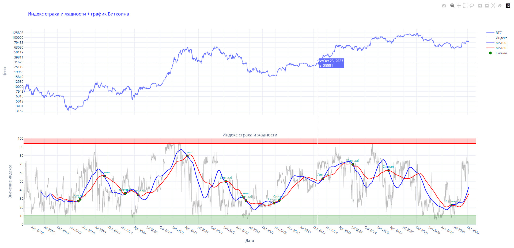
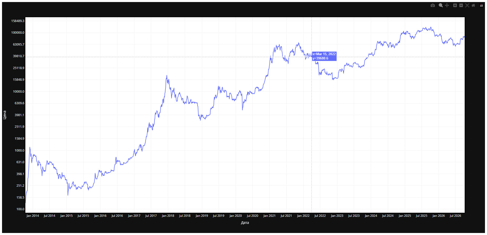
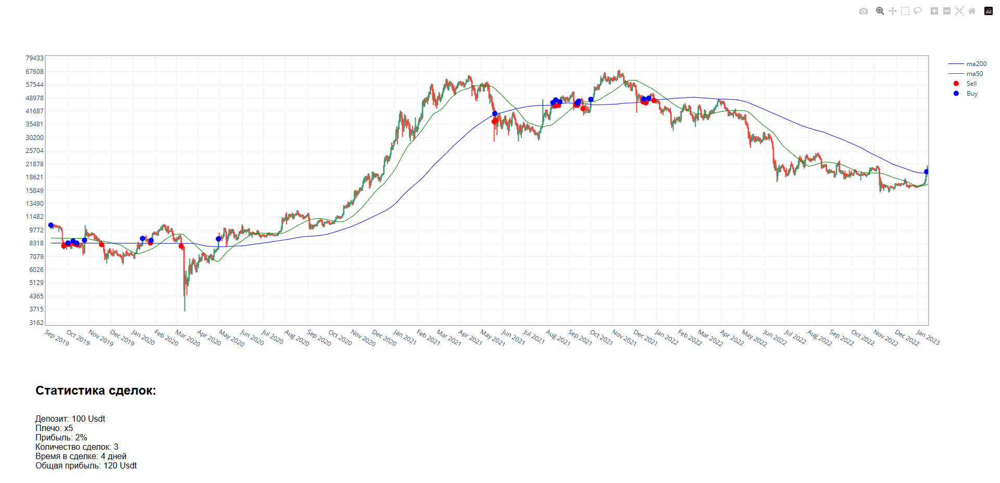

# Веб-панель аналитики Bitcoin на Django

Рабочее название: `Django_all_indicators`.

Веб-интерфейс для просмотра нескольких инструментов анализа Bitcoin. Django связывает страницы и обработчики запросов, pandas подготавливает данные, а Plotly формирует интерактивные HTML-графики. Главная страница служит навигацией между ценой, индексом настроений и свечным графиком.

**Python-портфолио Евгения Толмачева** · Python · Django · pandas · Plotly · Requests



## Скриншоты

<details>
<summary>Веб-панель аналитики Bitcoin на Django - 3 снимков</summary>

### Скриншот 1


### Скриншот 2



### Скриншот 3



</details>

## Возможности

- Показывает историю цены Bitcoin и отдельную страницу индекса страха и жадности.
- Добавляет на свечной график MA50 и MA200 и отмечает смену положения цены относительно MA200.
- Формирует HTML-графики на сервере и возвращает их через Django-представления.
- Объединяет страницы общей навигацией и именованными маршрутами.

## Как устроен проект

### Маршруты и навигация

[`Django_all_indicators/urls.py`](Django_all_indicators/urls.py), [`App/views.py`](App/views.py), [`templates/page.html`](templates/page.html)

Связывают адреса страниц с обработчиками и формируют меню инструментов.

### Цена и индекс настроений

[`App/newapp.py`](App/newapp.py), [`App/app2.py`](App/app2.py)

Загружают рыночные данные, подготавливают таблицы и сохраняют графики для отображения в шаблонах.

### Свечи и сигналы

[`App/plotly_charts.py`](App/plotly_charts.py), [`App/app3.py`](App/app3.py)

Читают историю свечей, рассчитывают средние и маркеры Buy/Sell, затем передают HTML-график на страницу.

## Технологии и их роль

- **Django**: Маршрутизация, обработка HTTP-запросов и вывод шаблонов.
- **pandas и NumPy**: Преобразование котировок, расчёт средних и подготовка маркеров сигналов.
- **Plotly**: Генерация графиков для встраивания в веб-страницы.
- **Requests**: Загрузка внешних данных для графиков цены и индекса.

## С чего начать просмотр кода


Маршруты и представления показывают устройство веб-части. Аналитическую обработку удобно изучать в App/plotly_charts.py и App/app2.py.

## Подготовка и запуск

Создайте отдельное окружение и установите исходные зависимости:

```powershell
python -m venv .venv
.venv\Scripts\Activate.ps1
python -m pip install -r requirements.txt
```

Задайте DJANGO_SECRET_KEY. Выполните python manage.py migrate. Отдельные представления читают dataframe.pkl, test.xlsx и output1.xlsx, которые не включены в репозиторий. Настройки предназначены для локальной разработки.

Переменные окружения: `DJANGO_SECRET_KEY`. Образец находится в [.env.example](.env.example). Сам файл .env автоматически не загружается: исходники читают окружение процесса. Значения нужно передать перед запуском, например в PowerShell:

```powershell
$env:DJANGO_SECRET_KEY = "YOUR_VALUE"
```

После подготовки настроек и необходимых данных основная точка входа:

```powershell
python manage.py runserver
```

`requirements.txt` сохранён из проекта. Это снимок окружения, а не гарантия совместимости с новейшей версией Python. Для старых проектов могут потребоваться соответствующая версия Python и настройка системных компонентов.

## Структура

```text
Django_all_indicators/
├── App/
│   ├── __init__.py
│   ├── app2.py
│   ├── app3.py
│   ├── calculate_profit.py
│   ├── newapp.py
│   ├── plotly_charts.py
│   └── views.py
├── Django_all_indicators/
│   ├── __init__.py
│   ├── asgi.py
│   ├── settings.py
│   ├── urls.py
│   └── wsgi.py
├── docs/
│   ├── preview.webp
│   └── screenshots/  # скриншоты из портфолио
├── static/
│   └── css/
│       └── style.css
├── templates/
│   └── page.html
├── .env.example
├── .gitignore
├── manage.py
├── README.md
└── requirements.txt
```

## Контекст и ограничения

Начат в 2022 году. В этой работе аналитические скрипты оформлены как веб-приложение: появляются маршрутизация, представления и шаблоны. Название страницы в исходниках содержит EMA, но сам расчёт в plotly_charts.py использует простые скользящие средние MA50 и MA200.

Проверены синтаксис Python-файлов и состав публикации. Полный запуск этой версии с внешними сервисами, локальными данными или моделями не выполнялся; команды выше описывают подготовку по исходникам.

## Состав репозитория

Сохранены авторские исходники, их имена и структура, зависимости и скриншоты интерфейса. Рабочие базы, наборы данных, модели и виртуальные окружения исключены. Секреты заменены обозначениями `YOUR_...` / `REDACTED_...`; реальные значения задаются локально. Исходные алгоритмы при оформлении портфолио не перерабатывались.

Автор: [Евгений Толмачев](https://github.com/EvgenyET) · [Портфолио](https://evgeny.tech/)
