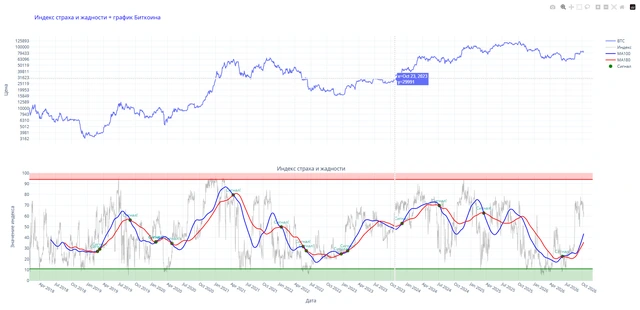

# Django_all_indicators

Сайт на Django с графиками Bitcoin, индексом страха и жадности и сигналами стратегии EMA.

**Python-портфолио Евгения Толмачева** · Начало: 2022 · Python · Django · pandas · Plotly



## Возможности

- Веб-интерфейс с несколькими графиками и индикаторами.
- Расчёт торговых сигналов по скользящим средним.
- Обработка исторических рыночных данных.

## Что смотреть в коде

Django views, подготовка данных для графиков и разделение шаблона, стилей и Python-кода.

Начните с `manage.py`. Названия авторских файлов и их расположение сохранены.

## Структура

```text
Django_all_indicators/
├── App/
│   ├── __init__.py
│   ├── app2.py
│   ├── app3.py
│   ├── calculate_profit.py
│   ├── newapp.py
│   ├── plotly_charts.py
│   └── views.py
├── Django_all_indicators/
│   ├── __init__.py
│   ├── asgi.py
│   ├── settings.py
│   ├── urls.py
│   └── wsgi.py
├── docs/
│   └── preview.webp
├── static/
│   └── css/
│       └── style.css
├── templates/
│   └── page.html
├── .env.example
├── .gitignore
├── manage.py
├── README.md
├── README.public.md
└── requirements.txt
```

## Подготовка и запуск

Это сохранённая версия пет-проекта, показывающая этап развития навыков. Для воспроизведения создайте отдельное окружение Python, совместимое с зафиксированными зависимостями:

```powershell
python -m venv .venv
.venv\Scripts\Activate.ps1
python -m pip install -r requirements.txt
```

Задайте DJANGO_SECRET_KEY. Выполните python manage.py migrate. Отдельные представления читают dataframe.pkl, test.xlsx и output1.xlsx, которые не включены в репозиторий. Настройки предназначены для локальной разработки.

Переменные окружения: `DJANGO_SECRET_KEY`. Образец находится в [.env.example](.env.example). Сам файл .env автоматически не загружается: исходники читают окружение процесса. Значения нужно передать перед запуском, например в PowerShell:

```powershell
$env:DJANGO_SECRET_KEY = "YOUR_VALUE"
```

После подготовки настроек и необходимых данных основная точка входа:

```powershell
python manage.py runserver
```

`requirements.txt` сохранён из проекта. Это снимок окружения, а не гарантия совместимости с новейшей версией Python. Для старых проектов могут потребоваться соответствующая версия Python и настройка системных компонентов.

## История и состав публикации

Начало - сентябрь 2022. Изменения - октябрь-ноябрь 2022, январь и апрель 2023, декабрь 2025.

В репозитории оставлены авторские исходники, зависимости и один компактный скриншот. Виртуальные окружения, сторонние библиотеки, рабочие базы, модели, большие наборы данных и персональные настройки не включены.

Чувствительные значения заменены понятными заглушками `YOUR_...` / `REDACTED_...`. Настоящие доступы не следует добавлять в Git. Алгоритмы и структура проекта при подготовке публикации не перерабатывались.

Проверена синтаксическая корректность Python-файлов и выполнено сканирование публикуемой копии на секреты. Полный запуск с внешними API, платежами, биржевыми операциями и локальными моделями не выполнялся.

Автор: [Евгений Толмачев](https://github.com/EvgenyET) · [Портфолио](https://evgeny.tech/)
